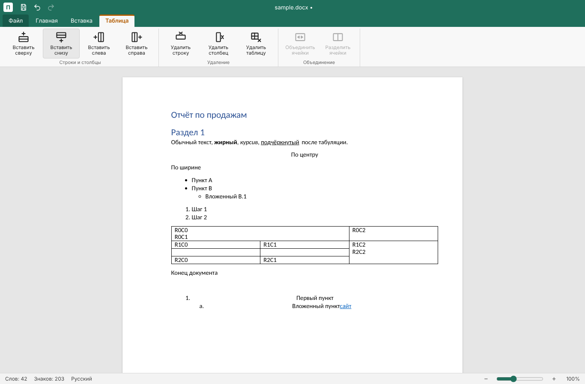

# Перо — редактор документов и таблиц для Windows

**Перо** — настольный текстовый редактор (аналог Word) и табличный редактор (аналог Excel) в одной программе.
Делается для внутреннего использования в компании, чтобы заменить платный Microsoft Office привычным по интерфейсу
и функциональности приложением: та же лента, те же клавиши, те же форматы файлов.



## Главное

- **Форматы Microsoft Office — своим кодом.** Открывает и сохраняет `.docx` и `.xlsx`, читает старые `.doc`
  (Word 97–2003) и читает/пишет `.xls` (Excel 97–2003), открывает и сохраняет CSV. Импорт и экспорт написаны с нуля
  по спецификациям ([ECMA-376], [MS-DOC], [MS-XLS], [MS-CFB]) — без LibreOffice, mammoth и других конвертеров,
  поэтому формат полностью под контролем проекта.
- **Бережное сохранение чужих файлов.** При сохранении заново пишется только то, что изменилось; всё, что Перо не
  редактирует (колонтитулы, сноски, примечания, рисунки, поля, диаграммы, сводные таблицы, условное форматирование…),
  переносится байт в байт. Если что-то всё же потеряется — программа предупредит и предложит сохранить копию.
- **Вёрстка как в Word, формулы как в Excel.** Разбиение на страницы сверено с Word через COM (страницы с текстом
  совпадают до символа); все 523 функции Excel с русскими именами, значения сверены с самим Excel на 870 формулах.
- **Свой облик.** Раскладка ленты и логика — как у Microsoft, а иконки, цвета (#1f6f5c) и название — свои.
- **Обычная Windows-программа.** Установщик (на пользователя или на машину, тихая установка для GPO/SCCM),
  ярлыки, «Открыть с помощью», автосохранение и восстановление после сбоя, журнал ошибок.

## Что умеет

**Документы (.docx, .doc)**
- Шрифт и абзац: гарнитура, размер, цвета, все виды подчёркивания, интервалы, отступы, линейка, диалоги «Шрифт» и «Абзац»,
  табуляция с заполнителями, границы и заливка абзаца, регистр, формат по образцу, непечатаемые знаки.
- Стили (встроенные стили Word и свои), списки и многоуровневая нумерация заголовков.
- Таблицы: объединение ячеек, границы, заливка, высота строк, повтор шапки, преобразование текст ↔ таблица, сортировка.
- Рисунки: вставка, размер, обрезка, поворот, обтекание текстом и положение на странице; показ фигур и надписей Word;
  формулы Word (OMML) показываются как формулы.
- Страницы: разбиение на листы, разделы с разной ориентацией и полями, колонки, колонтитулы (первая страница,
  чётные/нечётные), нумерация строк, переносы, подложка, цвет и границы страницы, печать и экспорт в PDF.
- Поля, оглавление, закладки, перекрёстные ссылки, сноски, примечания, режим исправлений, поиск и замена
  (в том числе подстановочные знаки и формат).

**Книги (.xlsx, .xls, .csv)**
- Ввод по-русски (числа, даты, проценты, рубли), числовые форматы как в Excel, «Формат ячеек», границы, объединение.
- Формулы: все функции Excel, включая Microsoft 365 (LAMBDA, ФИЛЬТР, СОРТ, РЕГТЕСТ…), динамические массивы,
  имена, ссылки на целые столбцы и другие листы; пересчёт только затронутых формул; подсказки при вводе, мастер функций,
  вычисление по шагам, стрелки зависимостей.
- Маркер заполнения, автофильтр, сортировка по нескольким столбцам, условное форматирование, проверка данных,
  найти и заменить, закрепление областей, группировка, защита листа, печать страницами как у Excel.
- Большие книги: 100 000 строк × 10 столбцов открываются за ~9 с, правка ячейки — меньше секунды.

План развития и то, что ещё не сделано, — в [docs/ROADMAP.md](docs/ROADMAP.md).

## Технологии

- [Electron](https://www.electronjs.org/) (contextIsolation + sandbox, доступ к системе — только через мост `window.pero`)
- [Vite](https://vitejs.dev/) + [React 19](https://react.dev/)
- [TipTap v3](https://tiptap.dev/) / [ProseMirror](https://prosemirror.net/) — ядро редактирования документов
- [JSZip](https://stuk.github.io/jszip/) + [@xmldom/xmldom](https://github.com/xmldom/xmldom) — пакеты OOXML
- [Vitest](https://vitest.dev/) — тесты; [electron-builder](https://www.electron.build/) (NSIS) — установщик

## Запуск

Нужны Windows 10/11 и Node.js 20+. Для части тестов — Python с пакетом `python-docx`.

```bash
npm install
npm run dev      # разработка: Vite (127.0.0.1:5183) + Electron с горячей перезагрузкой
npm test         # тесты
npm run build    # сборка интерфейса
npm run dist     # установщик → release/Pero-Setup-<версия>.exe
```

Установка: `Pero-Setup-x.y.z.exe` (мастер), `/S` — тихо на пользователя, `/S /allusers` — тихо на машину (нужен админ).

## Устройство

```
electron/          главный процесс: окна, меню, файлы, автосохранение, журнал, последние файлы
src/App.jsx        документ: состояние, файл, диалоги, строка состояния
src/Ribbon.jsx     лента документа
src/editor/        схема документа и функции редактора (шрифт, абзац, таблицы, страницы, поля, стили…)
src/docx/          .docx ↔ модель (import.js, export.js), .doc → пакет .docx (doc.js)
src/sheet/         табличный редактор: модель книги, формулы и функции, форматы, .xlsx/.xls/.csv, сетка, лента
src/formats/       составной файл Microsoft [MS-CFB] — контейнер .doc и .xls
tests/             тесты и генераторы эталонов (эталоны создаются самими Word и Excel через COM)
tools/             сканер книг компании (npm run scan)
```

Каждая функция форматирования делается в четырёх местах: расширение редактора → чтение из файла → запись в файл
(с порядком элементов по схеме) → тест «открыть → сохранить → открыть даёт то же самое».

## Проверка

Тесты сверяют Перо с настоящими Word и Excel: эталонные файлы создаются самими программами Microsoft через COM
(скрипты `tests/make_*_fixture.ps1`), затем модель, прочитанная Пером, сравнивается с тем, как файл понял Word/Excel.
Отдельно проверяются разбиение на страницы, обтекание рисунков, пересчёт формул, скорость на больших файлах
и устойчивость к повреждённым файлам.

## Состояние

Версия **0.17**. Готовы этапы 1–14, 16, 17 и 19.1–19.4 дорожной карты (этап 15 — шаблоны компании — ждёт решений): документы, книги, вёрстка, формулы, большие файлы,
чтение `.doc`, чтение и запись `.xls`. Дальше — запись `.doc`, OpenDocument (`.odt`, `.ods`) и RTF.

[ECMA-376]: https://ecma-international.org/publications-and-standards/standards/ecma-376/
[MS-DOC]: https://learn.microsoft.com/openspecs/office_file_formats/ms-doc/
[MS-XLS]: https://learn.microsoft.com/openspecs/office_file_formats/ms-xls/
[MS-CFB]: https://learn.microsoft.com/openspecs/windows_protocols/ms-cfb/

## Лицензия

[MIT](LICENSE).
